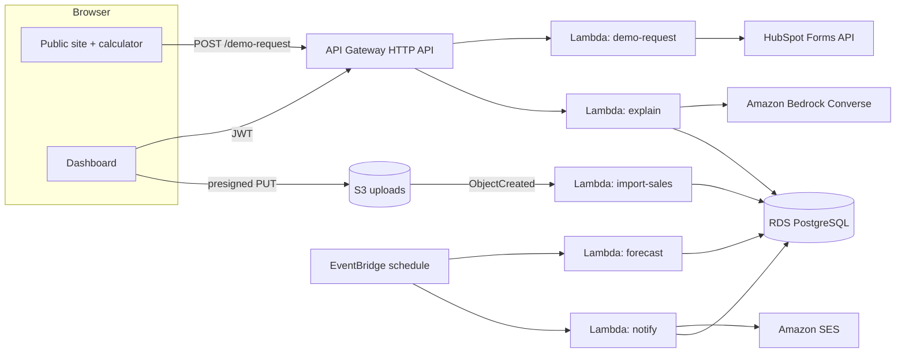

# Architecture

## Components
| Piece | Role |
|---|---|
| `src/engine` | Pure JS forecasting/inventory/purchasing code. Used identically by the browser demo, the calculator and the Lambdas, so there is one implementation of the maths. |
| PostgreSQL (`db/schema.sql`) | Source of truth: ingredients, lots, recipes, sales, suppliers/offers, forecast runs, recommendations (with the full explanation JSON), alerts. |
| S3 | Private, encrypted, TLS-only bucket for uploaded sales CSVs (`uploads/sales/…`). An object-created event triggers validation and upsert; rejects are recorded on `import_files`. |
| Lambda: forecast | Daily. Loads each active location, runs `runPlan`, saves a reproducible run (settings are stored with it). One failing location does not stop the others. |
| Lambda: notify | Sends a digest of new critical/warning alerts through SES, marking alerts notified only after a successful send. |
| Bedrock | `src/ai/bedrock.mjs`: Converse API turns a structured explanation into plain language. Prompt forbids new numbers and savings claims; any number in the reply that is not in the source data causes fallback to the deterministic text. Successful text is cached; fallbacks are not. |
| Demo-request Lambda | Validates, honeypot, forwards to HubSpot Forms API. |

## Security notes
- DB password is RDS-managed in Secrets Manager; Lambdas fetch it at runtime. DB is not publicly accessible; only the Lambda security group can reach it.
- Dashboard API routes use a JWT authoriser. **Before production:** enforce organisation/location ownership in every query (the explain handler currently relies on the id being unguessable plus the authoriser; add a tenancy check from the token claims), narrow the Bedrock IAM resource to the chosen model ARN, restrict `ses:SendEmail` to the verified identity, add WAF/rate limits on the public route.
- Lambdas in the VPC need a NAT gateway or VPC endpoints (S3, Secrets Manager, Bedrock Runtime, SES) to reach AWS services.

## Not built yet
Authentication/user management, the dashboard's server API (the demo runs entirely in the browser), presigned-upload endpoint, static hosting (S3 + CloudFront), HubSpot product-usage sync, multi-location rollups, and infrastructure deployment. `infra/template.yaml` passes cfn-lint but has not been deployed.
